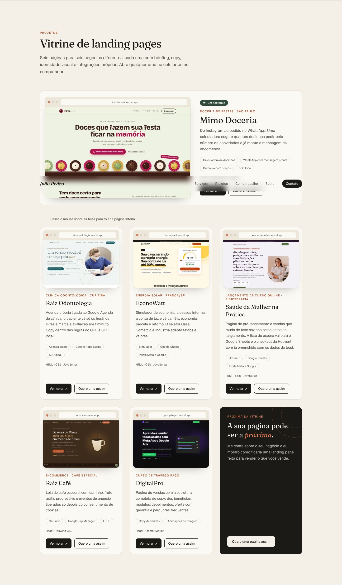
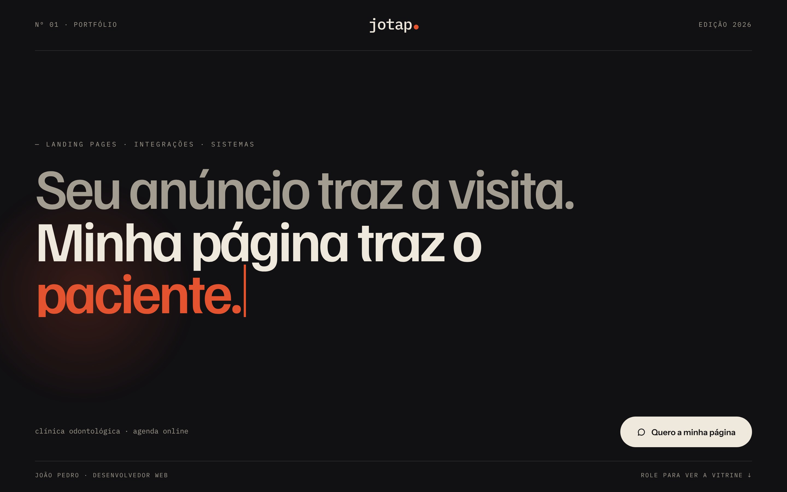
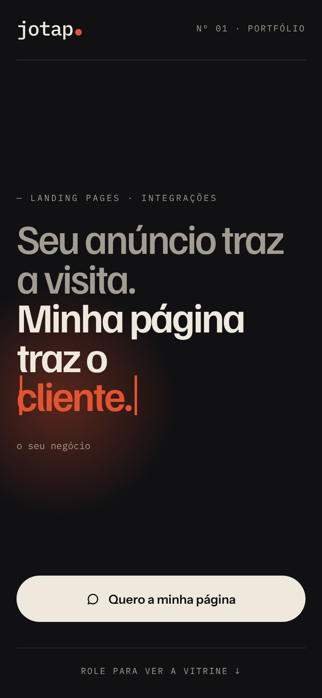

# Refatoração do portfólio · decisões e próximos passos

> Resumo da sessão de 28 e 29/10/2026. Serve de ponto de partida para a próxima conversa: cole este arquivo (ou peça para lê-lo) e siga da etapa 1.
> Imagens e protótipos ficam em `docs/refatoracao/`.

---

## 1. O que já está feito no código

**Vitrine de landing pages** (`src/components/Projects.jsx`, `src/data/projects.js`, `src/index.css`)

- A seção de projetos virou uma vitrine, inspirada na "Vitrine de landing pages" de [bianchini.dev](https://bianchini.dev/).
- Cada projeto aparece numa janela de navegador com o print da **página inteira**. Ao passar o mouse, a tela rola o print de cima a baixo. No celular, rola sozinha quando o card fica visível.
- Velocidade da rolagem: constante `SEGUNDOS_POR_TELA = 2.4` no topo de `Projects.jsx` (maior = mais devagar). Vale para todos os cards.
- Cada card tem dois botões: **"Ver no ar"** e **"Quero uma assim"** (WhatsApp com mensagem citando o projeto). Card final escuro: "A sua página pode ser a próxima".
- `links.js` ganhou `whatsappCom(mensagem)` para montar links do WhatsApp com mensagem pronta.

**Projetos, nesta ordem**

| # | Projeto | Endereço | Observação |
|---|---|---|---|
| Destaque | Mimo Doceria | mimodoceria.vercel.app | print refeito com a foto da confeiteira |
| 2 | Raiz Odontologia | raizodontologia.vercel.app | |
| 3 | EconoWatt | econowatt.vercel.app | |
| 4 | Raiz Café | raizcafe.vercel.app | |
| 5 | DigitalPro | lp-digitalpro.vercel.app | |

- LinguaFlow saiu do portfólio.
- Imagens: `public/projetos/<id>-pagina-720.webp` e `-1200.webp` (print de página inteira a 1440px de largura).
- **Para limpar:** `linguaflow-640/1200.webp`, `raiz-cafe-640/1200.webp`, `digitalpro-640/1200.webp`, `saude-da-mulher-640/1200.webp` não são mais usados.



---

## 2. Nova identidade: decisões

### Direção escolhida: "4.2a revisada"

Hero enxuto, só com três coisas: **título que se reescreve, um ponto de luz e o botão do WhatsApp**. Moldura editorial (número de edição, réguas finas, rodapé em fonte de código). Sem menu de navegação.

| Computador | Celular |
|---|---|
|  |  |

Protótipos abríveis no navegador: `refatoracao/hero-prototipo-computador.html` e `refatoracao/hero-prototipo-celular.html` (referência visual, não é o código final).

### Paleta "Noite de revista"

| Token | Cor | Uso |
|---|---|---|
| `bg` | `#111013` | fundo |
| `linha` | `#2E2B2F` | réguas e divisórias |
| `texto` | `#EFE8DC` | texto principal; fundo do botão |
| `suave` | `#A39C90` | 1ª frase do título, rótulos, legenda (contraste ~7:1) |
| `acento` | `#E4532F` | palavra que muda, ponto do "jotap.", cursor (só em texto grande) |
| `luz` | `rgba(228,83,47,.34)` | ponto de luz atrás da palavra |

O botão principal é claro (`texto`) com texto escuro (`bg`), não laranja.

### Tipografia

| Fonte | Uso | Pesos |
|---|---|---|
| **Familjen Grotesk** | título | 500 (1ª frase), 600 (resto) |
| **Instrument Sans** | texto e botão | 400, 500, 600 |
| **IBM Plex Mono** | "jotap.", rótulos em caixa alta, legenda, rodapé | 400, 500 |

Servir as fontes pelo próprio site (Fontsource), como o portfólio já faz hoje. Saem Fraunces e Geist.

### Topo

- Esquerda: `Nº 01 · PORTFÓLIO` (mono, caixa alta, espaçado). Direita: `EDIÇÃO 2026`. No celular: "jotap." à esquerda e `Nº 01 · PORTFÓLIO` à direita.
- Centro: símbolo **"jotap."** em IBM Plex Mono 500 (28px computador, 24px celular), com o **ponto em laranja que brilha junto com o ponto de luz do título**. É um link para o topo com `aria-label="João Pedro, voltar ao início"`.
- Régua fina abaixo do topo.
- O botão "Projetos ↓" saiu (era duplicado do rodapé).

### Título que se reescreve

```
Seu anúncio traz a visita.        ← cor suave, peso 500
Minha página traz o               ← cor texto, peso 600
[palavra].                        ← cor acento, com cursor piscando
```

- Palavras, nesta ordem: **paciente → pedido → orçamento → aluno → cliente**.
- Legenda em mono embaixo, trocando junto:
  - clínica odontológica · agenda online
  - doceria · pedido pelo WhatsApp
  - energia solar · simulador de economia
  - curso online · lançamento na Hotmart
  - o seu negócio · vamos conversar
- Rótulo acima do título: `— LANDING PAGES · INTEGRAÇÕES · SISTEMAS` (no celular, sem "sistemas").
- Tamanhos: **104px** no computador (alinhado à esquerda, margem de 64px, começa ~256px do topo); **50px** no celular (margem 20px, começa ~232px do topo). `letter-spacing: -0.05em`, `line-height: 0.92`.

### Animação

- Ciclo de **12,5s**: cada palavra tem 2,5s (digita em ~0,9s com `steps(9)`, fica, apaga).
- **Um único ponto de luz parado** atrás da palavra (gradiente radial), que acende levemente a cada troca (2,5s). Nada de luz se mexendo de um lado para o outro nem feixe vindo do alto.
- O ponto do "jotap." brilha no mesmo ritmo.

### Botão e rodapé

- Botão: **"Quero a minha página"**, com ícone de balão, pílula clara. No computador fica à direita, na mesma linha da legenda; no celular, largura total, perto do rodapé.
- Rodapé: régua fina + `JOÃO PEDRO · DESENVOLVEDOR WEB` à esquerda e `ROLE PARA VER A VITRINE ↓` à direita (no celular, só o segundo, centralizado).

### Cuidados obrigatórios na implementação

1. **SEO e leitor de tela:** o `<h1>` completo deve existir como texto ("Seu anúncio traz a visita. Minha página traz o cliente."). As palavras animadas ficam com `aria-hidden`.
2. **Bug do protótipo a corrigir:** com "reduzir movimento", as palavras escondidas ainda mostram o traço do cursor (aparece um "|" antes de "cliente."). No código final, esconder as palavras inativas de verdade (não deixar `display` no estilo inline brigar com a media query).
3. **Desempenho:** o título aparece na hora, sem esperar a animação (não piorar o LCP). Só animar `opacity`, `transform` e largura do texto.
4. **"Reduzir movimento":** mostrar direto "cliente." com a legenda "o seu negócio", sem cursor nem pulsar.
5. Manter as metas atuais: Lighthouse 100 em acessibilidade, boas práticas e SEO; desempenho 90+ no celular; zero erros no axe; de 320 a 1920px sem rolagem lateral.

---

## 3. O que foi descartado (para não repetir)

- Direção "Canvas de design" e o título "Eu desenho, construo e coloco no ar".
- Hero com muita informação: esteira de 8 etapas, página se montando, funil e registro de eventos no topo.
- Textos "Veja uma página nascer" e "Oito etapas entre a sua ideia e o primeiro cliente".
- Fundo creme claro (pouco contraste); "Linha de luz"; feixe de luz vindo do alto; luz que varre a tela de um lado para o outro.
- Nome "João Pedro" em serifada itálica no topo (destoava).
- Gostou, mas para outra seção: a esteira das 8 etapas da primeira direção (boa para "Como trabalho").

---

## 4. Conteúdo e material para as outras seções

- **Sobre (sem cara de currículo):** foto + uma frase ("Faço a landing page e o sistema por trás dela") + três números:
  - 4+ anos em empresas de software
  - ~40 lojas integradas a VTEX e Linx
  - 100 no Lighthouse
  - Linha do tempo curta: formado em TI → portais, APIs e automações → integrações VTEX/Linx → tutoriais para equipes → freelancer.
- **Processo (8 etapas da skill /landing-page):** briefing, persona, copy, identidade visual, código, integrações, testes, no ar. Cada uma com seu objeto (post-it, amostras de cor, trecho de código, nota do Lighthouse). Pensar a versão de celular como telas em sequência, não grade espremida.
- **Serviços:** ligar cada serviço a uma prova nos projetos (ex.: integrações → agenda da Raiz Odontologia, planilhas, checkout da Hotmart).
  - **Decisão pendente:** "Sistemas e painéis web" não tem prova visual. Opções: tirar por enquanto, deixar como secundário ("também desenvolvo"), ou criar um projeto (ex.: painel da recepção da Raiz Odontologia ou painel de leads da EconoWatt).

---

## 5. Próximas etapas

1. **Hero no código** com tudo da seção 2 (paleta, fontes, "jotap.", título que se reescreve, ponto de luz, botão, rodapé).
2. **Resto do site na nova identidade:** vitrine (só cor e fonte), serviços, processo, sobre, contato.
3. **Decidir o serviço de sistemas** (seção 4).
4. **Limpeza:** apagar imagens sem uso e atualizar o README (identidade, fontes, seções).
5. **Testes e publicação:** Lighthouse, axe, larguras, teclado e "reduzir movimento"; depois commit e deploy na Vercel.

---

## 6. Referências

- **Canvas com todas as rodadas** (privado, só você acessa): https://claude.ai/artifact/LJde3rPaFLyxbTyD1h3yW8. A versão final está na página "Rodada 4 · combinações", em "4.2a revisada".
- **Pesquisa de referências e UX** (privado): https://claude.ai/artifact/BnVuAsbM5L828GejJKAp95
- Princípios que guiaram a escolha:
  - **Ser incomum no espetáculo e convencional nos controles:** o hero é diferente, mas contato e rolagem funcionam como em qualquer site.
  - **Luz com função, não enfeite:** a luz evita o "escuro com neon" genérico.
  - **O celular é outra composição, não a versão encolhida.**
